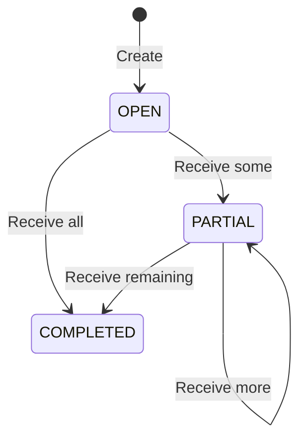

# Technical Specification

> Sumber: [PROJECT_SPEC.md](../PROJECT_SPEC.md). Fondasi Task 2 telah diimplementasikan; autentikasi dan fitur bisnis belum tersedia. Status per pemeriksaan ada di docs/testing.md (relatif terhadap root proyek).

## Baseline teknologi

| Bagian | Pilihan |
| --- | --- |
| Runtime backend | Node.js 24 |
| Backend | Express 5 + TypeScript strict |
| ORM | Prisma ORM 7 |
| Database | PostgreSQL 17 |
| Session dan limiter store | Redis |
| Frontend | React + TypeScript + Vite |
| Styling frontend (Task 2A) | Tailwind CSS v4 + HeroUI v3 |
| Routing frontend | React Router |
| Server state frontend | TanStack Query v5 |
| Validation | Zod |
| Session | express-session + connect-redis |
| CSRF | Synchronizer token melalui csrf-sync |
| Password | Argon2id |
| Rate limiting | express-rate-limit + rate-limit-redis |
| Backend testing | Vitest + Supertest |
| Frontend testing | React Testing Library + Playwright |
| Deployment | Docker Compose dan nginx |

Versi patch harus dipilih saat scaffolding, diperiksa kompatibilitasnya, lalu dikunci dalam lockfile. Prisma CLI, Client, dan adapter harus menggunakan versi yang kompatibel.

## Arsitektur dan dependency direction

Alur request:
Route → Middleware → Controller → Service → Repository → Prisma/PostgreSQL

Ketentuannya:

- Controller tidak mengakses Prisma secara langsung.
- Repository tidak menerima Request atau Response Express.
- Service menentukan aturan bisnis dan transaction boundary.
- Mapper mengubah database model menjadi DTO.
- Mapper tidak menjalankan query atau mengubah database.
- Service boleh mengoordinasikan beberapa repository dalam satu transaksi.
- Repository yang berjalan dalam transaksi harus menerima Prisma.TransactionClient.
- Operasi dalam transaksi tidak boleh menggunakan Prisma Client global sebagai jalan pintas.
- Tidak membuat generic base repository jika belum diperlukan.
app.ts membentuk aplikasi dan menerima dependency yang dibutuhkan untuk pengujian.

server.ts memuat konfigurasi, menghubungkan dependency, menjalankan listener, dan menangani shutdown.

## Konfigurasi Prisma multi-file

Untuk Prisma multi-file, arahkan CLI ke folder schema agar model di subfolder ikut terbaca. Prisma Client dihasilkan ke lokasi yang kamu minta. Pola folder dan custom output ini didukung dokumentasi Prisma. Prisma Documentation

Isi konfigurasi yang harus diwujudkan:

```text
schema directory: backend/prisma/
main schema: backend/prisma/schema.prisma
model files: backend/prisma/models/*.prisma
migrations: backend/prisma/migrations/
seed entry: backend/prisma/seeds/index.ts
generated client: backend/src/generated/prisma/
```

Aturan:

- Generator menggunakan prisma-client.
- Output relatif dari schema.prisma adalah ../src/generated/prisma.
- Prisma Client hasil generate tidak diedit manual.
- Environment lokal dimuat dari backend/env/.env.
- Runtime Prisma menggunakan adapter PostgreSQL yang sesuai dengan Prisma 7.
- Build dan Docker build menjalankan Prisma generate.
- Generated client tidak diimpor oleh frontend.
- Gunakan ESM dengan konfigurasi TypeScript dan import yang konsisten.
Desain database

Semua identifier entitas menggunakan UUID. Timestamp menggunakan PostgreSQL timestamptz.

Nama model Prisma menggunakan PascalCase. Nama tabel dan kolom PostgreSQL menggunakan snake_case melalui mapping Prisma.

| Tabel | Kolom |
| --- | --- |
| users | id uuid PK, email varchar(254) UNIQUE, name varchar(120), password_hash text, role enum, is_active boolean, auth_version integer, deleted_at timestamptz NULL, created_at timestamptz, updated_at timestamptz |
| products | id uuid PK, sku varchar(40) UNIQUE, name varchar(120), unit varchar(8), created_at timestamptz |
| receivings | id uuid PK, number varchar(40) UNIQUE, reference varchar(160), status enum, created_by uuid FK users, created_at timestamptz, updated_at timestamptz |
| receiving_items | id uuid PK, receiving_id uuid FK, product_id uuid FK, expected_quantity integer, received_quantity integer |
| receipts | id uuid PK, receiving_id uuid FK, actor_id uuid FK users, idempotency_key uuid, payload_hash char(64), received_at timestamptz |
| inventory_transactions | id uuid PK, receipt_id uuid, receiving_id uuid, receiving_item_id uuid, product_id uuid, quantity integer, created_at timestamptz |
| inventory_balances | product_id uuid PK/FK, available_quantity bigint, updated_at timestamptz |

Default:

- ID dibuat oleh server/database.
- users.is_active = true.
- users.auth_version = 1.
- users.deleted_at = null.
- products.unit = pcs.
- receivings.status = OPEN.
- receivings.reference = "".
- receiving_items.received_quantity = 0.
- inventory_balances.available_quantity = 0.
Nomor dokumen:
RCV-<UUID uppercase lengkap>

Panjangnya 40 karakter dan dibuat server.

## Constraint database

Wajib diwujudkan melalui Prisma dan SQL migration:

```text
UNIQUE users(email)
CHECK users(email = lower(email))
CHECK users(auth_version >= 1)
```

```text
UNIQUE products(sku)
CHECK products(sku matches ^[A-Z0-9_-]+$)
CHECK products(unit = 'pcs')
```

```text
UNIQUE receiving_items(receiving_id, product_id)
UNIQUE receiving_items(id, receiving_id, product_id)
CHECK receiving_items(expected_quantity BETWEEN 1 AND 1000000)
CHECK receiving_items(received_quantity >= 0)
CHECK receiving_items(received_quantity <= expected_quantity)
```

```text
UNIQUE receipts(receiving_id, idempotency_key)
UNIQUE receipts(id, receiving_id)
```

```text
UNIQUE inventory_transactions(receipt_id, receiving_item_id)
CHECK inventory_transactions(quantity BETWEEN 1 AND 1000000)
```

```text
CHECK inventory_balances(available_quantity >= 0)
```

Composite foreign key:

- (receipt_id, receiving_id) pada inventory transaction merujuk (id, receiving_id) pada receipt.
- (receiving_item_id, receiving_id, product_id) merujuk kombinasi yang sama pada receiving item.
Tujuannya memastikan receipt, receiving item, dokumen, dan produk dalam satu transaksi benar-benar konsisten.

Semua referensi historis menggunakan delete restriction. User hanya dihapus secara soft delete.

Index tambahan:
users(role, is_active)
users(created_at, id)

receivings(status, created_at, id)
receivings(created_at, id)

## receiving_items(product_id)

## receipts(actor_id)

inventory_transactions(product_id, created_at, id)
inventory_transactions(receiving_id, created_at, id)
inventory_transactions(receiving_item_id)
inventory_transactions(created_at, id)

## Inventory strategy

Gunakan dua representasi:

- inventory_transactions: ledger penerimaan.
- inventory_balances: saldo untuk pembacaan stok.
Keduanya diperbarui dalam transaksi PostgreSQL yang sama.

Invariant:
inventory_balances.available_quantity
=
SUM(inventory_transactions.quantity) untuk produk tersebut

Invariant tambahan:
receiving_items.received_quantity
=
SUM(inventory_transactions.quantity) untuk receiving item tersebut

availableQuantity dikirim sebagai decimal string, karena kolom database menggunakan bigint.

Contoh:

```json
{
  "availableQuantity": "100"
}
```

Saldo stok tidak di-cache di Redis pada versi ini.

## Session authentication

Session hanya menyimpan identitas minimum:

```typescript
interface SessionData {
  userId?: string;
  authVersion?: number;
  authenticatedAt?: number;
  anonymousCreatedAt?: number;
  csrfToken?: string;
}
```

Role otoritatif dibaca dari database pada setiap request terautentikasi.

Gunakan:

- Redis session store.
- resave: false.
- saveUninitialized: false.
- Rolling cookie untuk idle session.
- Cookie HttpOnly.
- Cookie host-only, tanpa atribut Domain.
- SameSite=Lax.
- Secure cookie untuk deployment HTTPS.
- Nama cookie lokal wrs.sid.
- Nama cookie HTTPS production __Host-wrs.sid, dengan Path /.
Cookie browser membawa session identifier; isi session disimpan di server. Konfigurasi secure cookie dan trusted proxy harus sesuai deployment. Express.js

Kebijakan waktu yang dipilih:

| Session | Batas |
| --- | --- |
| Anonymous/pre-login | Maksimal 15 menit |
| Authenticated idle timeout | 30 menit |
| Authenticated absolute lifetime | 8 jam sejak login |

TTL Redis dan cookie expiration harus konsisten. TTL session terautentikasi tidak boleh melampaui sisa absolute lifetime. connect-redis mendukung TTL dan mekanisme touch; pengaturannya harus disesuaikan dengan kebijakan ini. GitHub

Pada setiap protected request:

1. Pastikan session memiliki userId.
2. Periksa absolute lifetime.
3. Ambil user dari PostgreSQL.
4. Pastikan aktif dan belum terhapus.
5. Bandingkan session.authVersion dengan user.authVersion.

6. Isi req.user dari data database.
7. Jalankan authorization.
Session tidak valid menghasilkan 401. Kegagalan akses Redis/PostgreSQL menghasilkan 503, bukan dianggap kredensial salah.

## Login dan CSRF flow

Gunakan synchronizer token yang terikat session. Token dikirim melalui JSON response dan dikembalikan frontend melalui X-CSRF-Token. Login juga dilindungi menggunakan pre-login session. Setelah login berhasil, buat session baru untuk mencegah session fixation. Pola ini mengikuti panduan OWASP dan tersedia melalui csrf-sync. OWASP Cheat Sheet Series

Alur yang ditetapkan:
1. Frontend meminta GET /api/v1/auth/csrf-token.
2. Backend membuat anonymous session bila diperlukan.
3. Backend membuat token acak minimal 32 byte dan menyimpannya dalam session.
4. Backend menyimpan session sebelum mengirim token.
5. Frontend menyimpan token dalam memory.
6. Frontend mengirim login dengan cookie dan header CSRF.
7. Backend memvalidasi CSRF, input, rate limit, dan password.
8. Setelah kredensial valid, backend menjalankan session regeneration.
9. Session baru diisi userId, authVersion, dan authenticatedAt.
10. Buat CSRF token baru untuk session baru.
11. Simpan session baru sebelum mengirim response login.
12. Response berisi user dan CSRF token baru.
Ketentuan tambahan:
- Token stabil selama session tersebut berlaku.
- GET /csrf-token mengembalikan token yang masih berlaku, bukan selalu merotasinya.
- POST, PATCH, PUT, dan DELETE wajib menjalani pemeriksaan CSRF.
- Token tidak dikirim melalui URL atau ditulis ke log.
- Mutating request wajib memakai JSON.
- Periksa Origin terhadap APP_ORIGIN; bila tidak ada, gunakan origin dari Referer.
- Request perubahan data tanpa Origin/Referer yang dipercaya ditolak dalam aplikasi ini.
- GET bisnis tidak mengubah state bisnis.
- Endpoint CSRF bootstrap hanya menginisialisasi state keamanan session.
Logout menghancurkan session Redis, menunggu hasilnya, lalu menghapus cookie dengan atribut yang sesuai.

## Password security

Password menggunakan Argon2id dengan salt otomatis. Baseline minimal:

```text
memoryCost: 19456 KiB
timeCost: 2
parallelism: 1
```


Parameter tersebut mengikuti rekomendasi minimum OWASP; waktu hashing perlu diperiksa di lingkungan implementasi. OWASP Cheat Sheet Series

Tidak menyimpan plaintext password, tidak mengembalikan hash, dan menggunakan pesan login umum untuk kredensial salah maupun akun yang tidak dapat digunakan.

## User management dan session revocation
- Create user mewajibkan role eksplisit.
- Update hanya menerima name, role, isActive.
- Perubahan role/status yang benar-benar terjadi menaikkan authVersion.
- Soft delete mengisi deletedAt, mengubah isActive=false, dan menaikkan authVersion.
- Perubahan nama saja tidak membatalkan session.
- Semua user-management mutation mengambil satu PostgreSQL transaction advisory lock yang sama.
- Setelah lock diperoleh, periksa kembali actor masih supervisor aktif.
- Evaluasi invariant minimal satu supervisor aktif di dalam transaksi tersebut.
- Penghapusan ulang user yang sudah terhapus menghasilkan 204 tanpa perubahan tambahan.
Penggunaan lock di sini mencegah dua supervisor melakukan perubahan bersamaan yang melanggar invariant akun.

## Redis dan rate limiting

Redis digunakan untuk:

```text
wrs:sess:*            session
wrs:rl:global:*       global IP limiter
wrs:rl:login-ip:*     login IP limiter
wrs:rl:login-pair:*   login IP + normalized-email limiter
wrs:rl:user:*         authenticated-user limiter
```


Setiap limiter memiliki store/prefix terpisah. rate-limit-redis menyediakan shared store bagi express-rate-limit. GitHub

Batas awal yang dipilih:

| Limiter | Batas |
| --- | --- |
| Seluruh /api/v1 per IP | 300 request/menit |
| Login per IP | 10 request/15 menit |
| Login per IP + email | 5 request/15 menit |
| Protected API per user | 120 request/menit |


Ketentuan:
- Login limiter menghitung percobaan tanpa membocorkan keberadaan email.
- Key email menggunakan hash dari email yang dinormalisasi.
- Penanganan IP menggunakan dukungan IPv4/IPv6 dari library.
- Response limit adalah 429 dengan Retry-After.
- Gangguan store menghasilkan 503; limit tidak dilewati.
- Atur passOnStoreError agar request ditolak saat store gagal.
- trust proxy harus sesuai topologi proxy, bukan menerima seluruh forwarded header tanpa batas.
- Health endpoints tidak melewati session dan limiter bisnis.
Konfigurasi perilaku store error dan respons limiter tersedia pada dokumentasi library. express-rate-limit

## Receiving transaction

Gunakan Prisma interactive transaction. Locking yang membutuhkan SQL dijalankan melalui parameterized raw query pada transaction client yang sama. Prisma mendukung kedua mekanisme tersebut. prisma.io

Urutannya wajib:
1. Authentication, authorization, CSRF, dan validasi input selesai.
2. Normalisasi UUID menjadi lowercase.
3. Urutkan payload item berdasarkan receivingItemId.
4. Hitung SHA-256 dari:
   - Receiving ID.
   - Actor ID.
   - Array item yang telah dinormalisasi.
5. Mulai transaksi PostgreSQL READ COMMITTED.
6. Lock row receiving menggunakan SELECT ... FOR UPDATE.
7. Cari receipt berdasarkan (receivingId, idempotencyKey).
8. Jika ditemukan:
   - Hash sama: kembalikan receipt lama tanpa write.
   - Hash berbeda: 409 IDEMPOTENCY_CONFLICT.
9. Jika belum ditemukan, tolak dokumen completed.
10. Baca dan lock item dokumen.
11. Validasi seluruh item dan remaining quantity sebelum melakukan write.
12. Buat receipt.
13. Increment received quantity setiap item.
14. Buat inventory transaction setiap item.
15. Increment inventory balance menggunakan operasi database atomik.
16. Update balance dalam urutan productId yang konsisten untuk mengurangi deadlock antar dokumen.
17. Hitung status dokumen dari seluruh item.
18. Update dokumen.
19. Commit.
20. Kirim response receipt.
Larangan:
- Membaca remaining quantity sebelum lock lalu memakainya untuk mengambil keputusan.
- Menyimpan idempotency hanya di Redis.
- Melakukan network call atau hashing password di dalam receiving transaction.
- Menulis sebagian perubahan di luar transaction client.
- Mengembalikan sukses sebelum commit.
Replayed receipt diperiksa sebelum penolakan status completed.

Response replay berisi receipt historis yang immutable, bukan snapshot dokumen yang sudah berubah akibat receipt lain.

## State transitions



Tidak ada endpoint manual complete, reopen, cancel, edit expected quantity, atau delete receipt.

## Frontend dan TanStack Query

Semua server-state read menggunakan useQuery. Semua operasi perubahan state server menggunakan useMutation, termasuk login dan logout.

Query key:

```text
["auth", "me"]
```


```text
["users", "list", filters]
["users", "detail", userId]
```


```text
["products", "list", filters]
["products", "detail", productId]
```


```text
["receivings", "list", filters]
["receivings", "detail", receivingId]
```


```text
["inventory", "list", filters]
["inventory", "transactions", filters]
```


Invalidasi:

| Mutation | Query yang diperbarui |
| --- | --- |
| Login | Set data auth/me, gunakan CSRF baru |
| Logout | Hapus seluruh query cache dan CSRF memory |
| Create/update/delete user | User list dan detail terkait |
| Create product | Product list dan inventory list |
| Create receiving | Receiving list |
| Receive items | Receiving detail, receiving list, inventory list, transaction history |


TanStack Query mendukung invalidasi query terkait melalui callback mutation. Promise invalidasi dapat ditunggu agar status mutation tetap pending sampai pembaruan selesai. TanStack Query React Docs

Ketentuan mutation penerimaan:
- retry: false secara eksplisit.
- Buat idempotency key sebelum mengirim mutation.
- Simpan key dan payload bersama sebagai satu pending operation.
- Simpan pending operation di sessionStorage, dipisahkan berdasarkan actor dan receiving ID.
- Tidak menyimpan password, session ID, atau CSRF token dalam pending operation.
- Jika response hilang atau terjadi 5xx, retry menggunakan key dan payload yang sama.
- Reload, login ulang, atau logout tidak boleh otomatis membuat key baru untuk operasi yang belum diketahui hasilnya.
- IDEMPOTENCY_CONFLICT memerlukan pemeriksaan riwayat; jangan otomatis mengirim ulang dengan key baru.
- Tidak melakukan optimistic increment stok.
- Kegagalan refetch setelah mutation sukses ditampilkan sebagai masalah refresh, bukan mengubah status receipt menjadi gagal.
- Pada 401, hentikan protected queries dan hapus cached data user sebelumnya.
- CSRF token kedaluwarsa dapat diambil ulang; mutating request hanya boleh diulang sekali setelah error CSRF yang dipastikan terjadi sebelum service dijalankan.
Migration dan deployment
- Migrasi dibuat dengan Prisma Migrate.
- Check constraint dan composite FK tambahan harus ada dalam SQL migration.
- migrate dev hanya untuk development.
- Deployment menggunakan migrate deploy.
- Jangan mengubah migration yang sudah diterapkan.
- Seed dijalankan eksplisit.
- Seed tidak mereset password akun yang sudah ada.
- Semua secret berasal dari environment.
- Gunakan satu migration/seed job sebelum API siap melayani.
- Redis dan PostgreSQL tidak diekspos ke internet.

Struktur repository

Gunakan npm workspaces dengan dua aplikasi: backend dan frontend.

| Lokasi | Isi dan tanggung jawab |
| --- | --- |
| docs/ | PRD, technical specification, ERD, API contract, diagram, AI workflow, testing |
| backend/prisma/schema.prisma | Konfigurasi generator dan datasource Prisma |
| backend/prisma/models/ | Model Prisma yang dipisahkan berdasarkan domain |
| backend/prisma/migrations/ | Migrasi Prisma beserta SQL constraint tambahan |
| backend/prisma/seeds/ | Seed akun awal |
| backend/src/common/cache/ | Konfigurasi session store dan rate-limit store Redis |
| backend/src/common/errors/ | Error aplikasi dan pemetaan error |
| backend/src/common/middlewares/ | Authentication, authorization, validation, request ID, error handler |
| backend/src/common/security/ | Password hashing, CSRF, konfigurasi session dan rate limiting |
| backend/src/config/ | Validasi dan pemuatan environment |
| backend/src/generated/prisma/ | Prisma Client hasil generate |
| backend/src/lib/ | Instance Prisma, Redis, dan logger |
| backend/src/modules/ | Modul bisnis |
| backend/src/types/express-session.d.ts | Penambahan tipe data session |
| backend/src/types/express.d.ts | Tipe req.user dan req.requestId |
| backend/src/routes/ | Penggabungan route aplikasi |
| backend/env/.env.example | Contoh konfigurasi tanpa secret |
| backend/env/.env | Konfigurasi lokal, diabaikan Git |
| backend/app.ts | Membentuk Express application tanpa menjalankan listener |
| backend/server.ts | Menjalankan server dan graceful shutdown |
| backend/docker/ | Dockerfile dan kebutuhan container backend |
| backend/prisma.config.ts | Konfigurasi Prisma CLI |
| backend/tests/ | Unit dan integration tests |
| frontend/src/app/router.tsx | Definisi route frontend |
| frontend/src/app/providers.tsx | QueryClientProvider dan provider aplikasi |
| frontend/src/assets/ | Aset statis |
| frontend/src/components/layout/ | Layout autentikasi dan dashboard |
| frontend/src/components/shared/ | Komponen lintas fitur |
| frontend/src/config/env.ts | Validasi environment publik frontend |
| frontend/src/config/http-client.ts | HTTP client, credentials, CSRF, error normalization |
| frontend/src/config/query-client.ts | Konfigurasi TanStack Query |
| frontend/src/features/ | Implementasi setiap fitur |
| frontend/src/hooks/ | Hook global yang benar-benar digunakan lintas fitur |
| frontend/src/pages/ | Komponen halaman route |
| frontend/src/styles/ | Styles global |
| frontend/src/main.tsx | Entry point frontend |
| frontend/tests/ | Component dan browser tests |
| frontend/docker/ | Dockerfile dan konfigurasi nginx |
| compose.yaml | PostgreSQL, Redis, migration job, API, frontend |
| AGENTS.md | Aturan bagi Codex |
| README.md | Panduan menjalankan dan meninjau proyek |

Modul backend yang dibutuhkan:
auth
users
products
receivings
inventory
health

Setiap modul bisnis menggunakan pola berikut:

```text
<module>.schema.ts
<module>.repository.ts
<module>.mapper.ts
<module>.service.ts
<module>.controller.ts
<module>.route.ts
```

Pembagian tanggung jawabnya:

| File | Tanggung jawab |
| --- | --- |
| schema.ts | Validasi body, params, query, dan tipe input |
| repository.ts | Akses Prisma dan SQL yang diperlukan |
| mapper.ts | Mengubah model database menjadi response DTO |
| service.ts | Aturan bisnis dan batas transaksi |
| controller.ts | Membaca request tervalidasi dan membentuk HTTP response |
| route.ts | Endpoint serta urutan middleware |

Untuk health, buat hanya file yang diperlukan. Tidak perlu memaksakan repository atau mapper kosong.

Fitur frontend:
auth
users
products
receivings
inventory

Contoh isi fitur penerimaan:

```text
features/receivings/api/receivings.api.ts
features/receivings/components/ReceivingForm.tsx
features/receivings/components/ReceivingItemsTable.tsx
features/receivings/components/ReceiveItemsForm.tsx
features/receivings/hooks/useReceivingsQuery.ts
features/receivings/hooks/useReceivingDetailQuery.ts
features/receivings/hooks/useCreateReceivingMutation.ts
features/receivings/hooks/useReceiveItemsMutation.ts
features/receivings/types/receivings.types.ts
```

Tambahkan catatan berikut di technical specification, bukan di sintaks ERD:

- Satu produk hanya sekali dalam satu receiving.
- Satu key hanya sekali dalam satu receiving.
- Satu receiving item hanya sekali dalam satu receipt.
- Composite foreign key memastikan receipt, dokumen, item, dan produk saling sesuai.
- User tidak dihapus secara fisik.
- Inventory transaction tidak memiliki endpoint update/delete.

Penjelasan tambahan di technical specification:

- Redis bukan bagian dari transaksi inventory.
- Gangguan pengiriman response setelah commit merupakan hasil yang belum diketahui client.
- Client menyelesaikannya melalui replay key yang sama.
- Frontend mengambil kembali state server setelah receipt terkonfirmasi.

## Ketidakkonsistenan dan keputusan yang masih terbuka

- Diagram sumber berupa artefak CSS/teks hasil render, bukan sintaks Mermaid. ERD, state transitions, dan data flow direkonstruksi dari desain database, aturan bisnis, urutan transaksi, dan label diagram sumber.
- Sumber menyebut ?delapan dokumen? kemudian menambahkan AGENTS.md; keluaran tahap ini berjumlah sembilan file sesuai permintaan.
- `docs/openapi.yaml` telah dibuat dan divalidasi pada Task 1; lihat bukti aktual di testing.md. Implementasi endpoint tetap belum dimulai.
- Istilah ?CRUD user? dibatasi kontrak: update hanya name, role, isActive; delete berupa soft delete. Perubahan email, reset password, dan pemulihan user terhapus tetap di luar scope.
- Langkah receiving menyebut authorization selesai sebelum transaksi, sedangkan user management secara eksplisit memeriksa ulang actor sesudah advisory lock. Ini konsisten dengan BR-U12: request yang telah berjalan sebelum pencabutan boleh selesai; request baru wajib ditolak.
- PRD menetapkan batas panjang password berdasarkan Unicode code point, tetapi satuan hitung panjang nama, SKU, dan reference belum diperinci. Jangan mengubah batas yang telah dinyatakan; detail implementasi perlu dicatat saat scaffolding.
- SessionData memuat anonymousCreatedAt, sementara daftar isi session pascalogin hanya menyebut userId, authVersion, authenticatedAt dan token baru. Tetapkan lifecycle anonymousCreatedAt saat implementasi tanpa melampaui batas anonymous 15 menit.
- Nama sumber eksternal (PDF assessment, Prisma, Express, GitHub, OWASP, TanStack Query) tercantum tanpa URL lengkap atau isi PDF. Klaim terhadap sumber eksternal belum diverifikasi; dokumentasi ini mempertahankan keputusan PROJECT_SPEC.md.

Seluruh pertanyaan stakeholder dalam PRD tetap terbuka. Keputusan eksplisit PRD berlaku selama belum ada jawaban. Tidak ada aturan bisnis yang diperluas pada tahap pemisahan dokumentasi ini.

## Hasil peninjauan Task 1

Register lengkap: [spec-review.md](spec-review.md); rencana dependency resmi: [dependency-plan.md](dependency-plan.md); mapping 87 ID: [requirement-mapping.md](requirement-mapping.md).

- anonymousCreatedAt hanya untuk anonymous/pre-login. Session authenticated dibuat ulang sesuai flow dengan authenticatedAt baru; clock anonymous tidak dijadikan clock absolute authenticated.
- Semua mutation mengirim Content-Type application/json. Logout dan DELETE tetap tanpa body sesuai kontrak; jangan menambah required empty object.
- Tetapkan `passOnStoreError: false`; store error diteruskan ke error handler dan dipetakan ke 503 DEPENDENCY_UNAVAILABLE, tanpa limiter/session fallback. Ini memperjelas konfigurasi yang sebelumnya hanya menyebut perilaku.
- Keunikan ID item diperiksa setelah UUID lowercase; JSON Schema uniqueItems saja tidak cukup. SKU divalidasi sesudah trim+uppercase; password dihitung per Unicode code point tanpa trim/normalisasi.
- ReceiptDto.items berasal dari ledger inventory_transactions untuk receipt tersebut; tidak menambah entitas receipt_items. Receiving detail wajib konsisten snapshot; mekanisme query dipilih saat implementasi.
- Pertanyaan unit panjang teks non-password dan error not-found yang belum dinamai tetap terbuka sebelum endpoint terkait. Default hak akses/satuan/koreksi mengikuti PRD; bukan blocker scaffold/database Task 2.
- ERD tidak menggantikan SQL composite FK/CHECK maupun service invariants. Review semantik diagram telah dilakukan; rendering Mermaid NOT_RUN.

## Implementasi fondasi Task 2

- Schema multi-file dan generated output mengikuti rancangan; Prisma CLI/Client/adapter-pg 7.10.1. PostgreSQL 17.11 dan Redis 8.2.11 dipin dengan digest pada Compose. Versi npm yang terverifikasi menjadi 11.6.2 karena resolver npm 10 gagal; rincian pada dependency-plan.md.
- Composite foreign keys dapat diekspresikan langsung melalui relation Prisma dan tercakup SQL initial migration. Sembilan CHECK ditambahkan ke SQL sebelum migration pertama kali diterapkan. Applied migration tidak diubah setelah verifikasi.
- Product.balance bersifat optional pada sisi parent di Prisma karena FK tidak bisa menjamin setiap parent memiliki child. ERD tetap menggambarkan invariant bisnis satu balance per product, yang wajib dipenuhi transaksi create product pada Task 4. Tidak menambahkan trigger/endpoint di luar scope.
- Seed uses account-management advisory lock 735910001 melalui common/security/account-lock.ts. Task 5 wajib memakai konstanta yang sama. Seed menolak setup tanpa supervisor aktif namun tidak mereset field akun existing, termasuk deleted/nonaktif.
- Seed name divalidasi terhadap kapasitas varchar(120) PostgreSQL; ini bukan keputusan umum untuk unit panjang API yang masih R-11. Password seed 12-128 Unicode code point tanpa normalisasi. Semua seed credentials berasal dari env.
- Environment backend dimuat dari backend/env/.env dengan process env lebih diutamakan. BACKEND_ENV_FILE opsional menunjuk file eksplisit untuk verifikasi. Validasi runtime, CLI Prisma (DATABASE_URL), dan seed credentials dipisah agar migrasi/generate tidak memerlukan seed password atau session secret. Runtime masih mewajibkan konfigurasi keamanan baseline walaupun endpoint auth belum diimplementasikan.
- Health tidak memasang session atau limiter bisnis. Readiness menguji akses tabel/kolom identitas seluruh tujuh model dan Redis PING; server melakukan readiness sebelum listen. Query gagal/koneksi gagal menghasilkan 503 aman pada readiness; liveness tidak tergantung dependency.
- Graceful shutdown menunggu HTTP close lalu Prisma disconnect dan Redis close, dibatasi deadline 10 detik. Jalur yang sama diekspor sebagai startServer/shutdown untuk integration test; signal SIGINT/SIGTERM dihubungkan saat server berjalan. Pengiriman signal dari PTY Windows belum terkonfirmasi, bukan PASS.
- Compose saat ini hanya dependency postgres/redis lokal. Migration job, API/web Dockerfile dan nginx direncanakan pada Task 7. Tidak ada auth atau business route yang tersedia pada tahap ini.

## Task 2A — Fondasi UI

- Stack UI: Tailwind CSS 4.3.3 dengan @tailwindcss/vite 4.3.3; @heroui/react dan @heroui/styles 3.2.6. React/React DOM tetap 19.3.1, memenuhi peer HeroUI >=19; Vite tetap 7.3.7, diterima peer plugin Tailwind. npm tetap 11.6.2 dan struktur workspaces tidak berubah.
- Vite memakai plugins react() dan tailwindcss(); tidak menambahkan konfigurasi/plugin Tailwind v3 atau heroui() v2. HeroUI v3 tidak memerlukan HeroUIProvider. QueryClientProvider dan BrowserRouter yang sudah ada dipertahankan.
- Entry stylesheet tetap frontend/src/styles/global.css, diimpor sekali oleh main.tsx. Urutan CSS: @import "tailwindcss" lalu @import "@heroui/styles". Penyesuaian global minimum berada pada @layer base; layout contoh memakai utility Tailwind dan token warna HeroUI, tanpa override global main/h1 yang menimpa komponen.
- FoundationPage pada route / hanya contoh Card compound v3 dan Button (onPress, variant primary/secondary, isDisabled), serta blok utility Tailwind. Counter memakai state lokal untuk verifikasi interaksi, tanpa request API atau mutasi bisnis. Import komponen memakai public subpath @heroui/react/button dan @heroui/react/card.
- Keputusan kompatibilitas TypeScript: strict tetap true, skipLibCheck tetap false, noUncheckedIndexedAccess tetap true. Frontend mengoverride exactOptionalPropertyTypes menjadi false karena deklarasi React Aria GroupProps/OverlayArrowProps berbenturan dengan DOMProps bila opsi tambahan itu true. Percobaan HeroUI 3.2.6 dengan peer otomatis dan pin React Aria 1.21.1, serta HeroUI 3.0.5, tidak menyelesaikan konflik. Versi final kembali ke HeroUI 3.2.6; tidak ada pin React Aria percobaan yang tersisa di manifest.
- Dampak pengecualian tersebut: optional properties frontend boleh diberi undefined secara eksplisit. Ini mengurangi ketegasan tambahan optional-property frontend dibanding Task 2; backend dan tsconfig.base tetap exactOptionalPropertyTypes true. Tidak memakai skipLibCheck, @ts-ignore, any, patch node_modules atau force/legacy-peer-deps. Tinjau kembali pengecualian ketika deklarasi upstream kompatibel. Validasi input backend tetap otoritatif.
- Dasar resmi: [HeroUI quick start v3](https://heroui.com/en/docs/react/getting-started/quick-start), [HeroUI Vite integration](https://heroui.com/en/docs/react/getting-started/frameworks#vite), [release 3.2.6](https://heroui.com/en/docs/react/releases/v3-2-6), [Tailwind v4 Vite plugin](https://tailwindcss.com/docs/installation/using-vite), [TypeScript exactOptionalPropertyTypes](https://www.typescriptlang.org/tsconfig/exactOptionalPropertyTypes.html).

## Persiapan repository mandiri sebelum Task 3

Atas permintaan pengguna, backend/frontend disiapkan untuk dua repository GitHub terpisah tanpa melakukan operasi Git. Setiap folder kini mempunyai dependency dev yang semula hanya dideklarasikan root (TypeScript, @types/node, ESLint/@eslint/js/typescript-eslint), package-lock lokal, packageManager/engines, .npmrc/.nvmrc, ESLint lokal dan tsconfig tanpa extends ke parent. Versi paket langsung dipertahankan; lockfile mandiri menyelesaikan dependency transitive masing-masing, sehingga tidak mengasumsikan deduplikasi dengan aplikasi saudara.

Root workspaces dan konfigurasi/dokumentasi sumber tetap dipertahankan; root package-lock diselaraskan untuk mode gabungan. Ketika dipisah, setiap repository memakai lockfile miliknya sendiri. Frontend tetap memakai pengecualian optional-property Task 2A; backend tetap exactOptionalPropertyTypes true.

Prisma codegen/schema validation sekarang memakai prisma.generate.config.ts tanpa datasource URL. typecheck/build backend otomatis generate client, sehingga npm ci/lint/typecheck/build dari clone baru tidak memerlukan generated client yang di-commit, file env, database atau Redis. Migration/seed tetap memakai prisma.config.ts dengan URL eksplisit; runtime env validation tidak dilonggarkan. Tidak ada migration atau seed dijalankan pada tahap pemisahan.

Backend mendapat compose.yaml lokal dengan nama project default warehouse-receiving-backend untuk dependency lokal, tanpa mengubah Compose asli atau volume existing. README dan docs/verification.md masing-masing repository memuat instruksi mandiri. Dokumentasi spesifikasi lengkap tetap dipertahankan di proyek sumber dan bukan dependency build repository terpisah.
